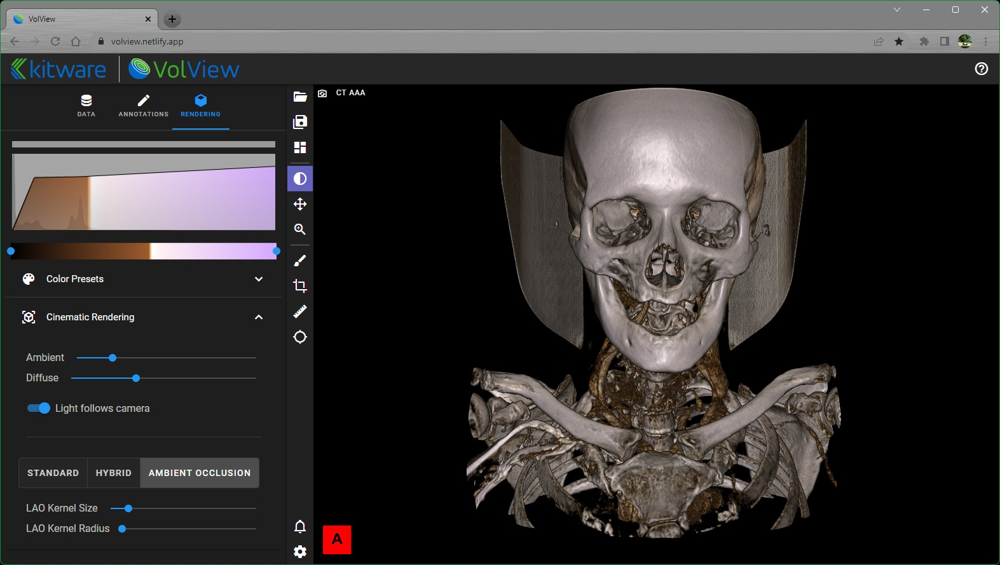
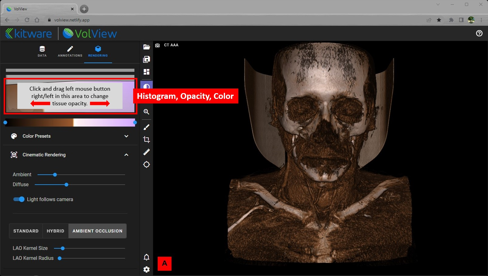
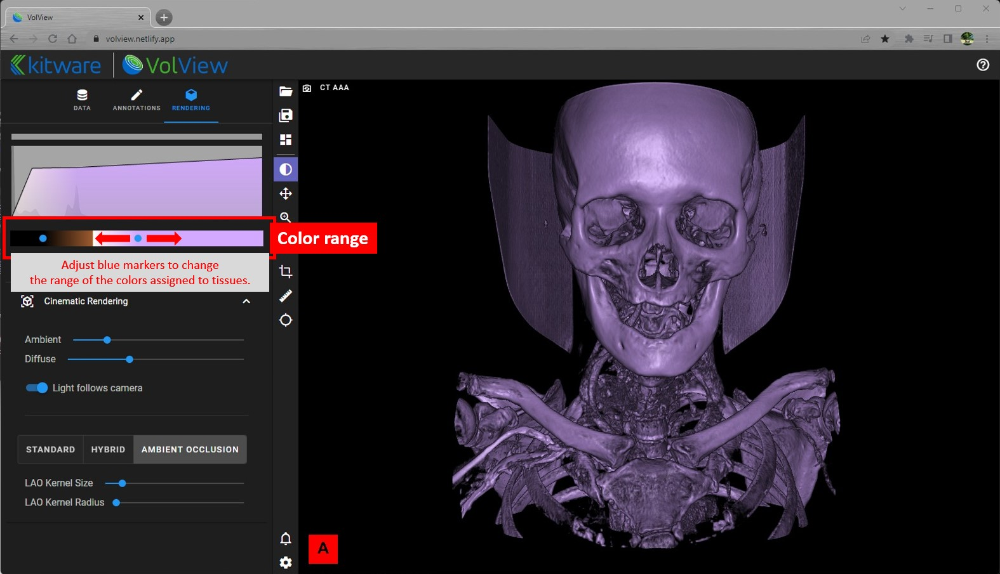
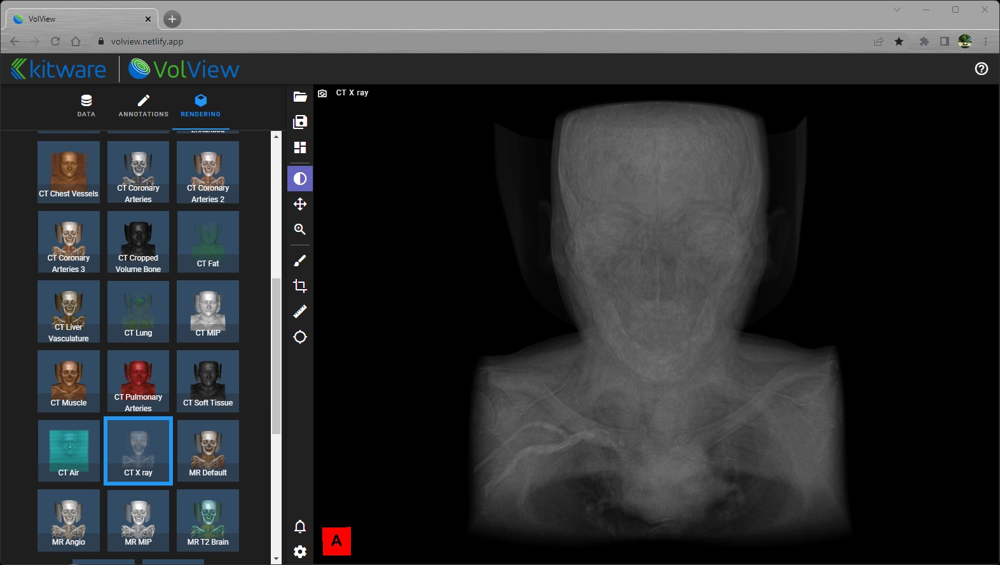
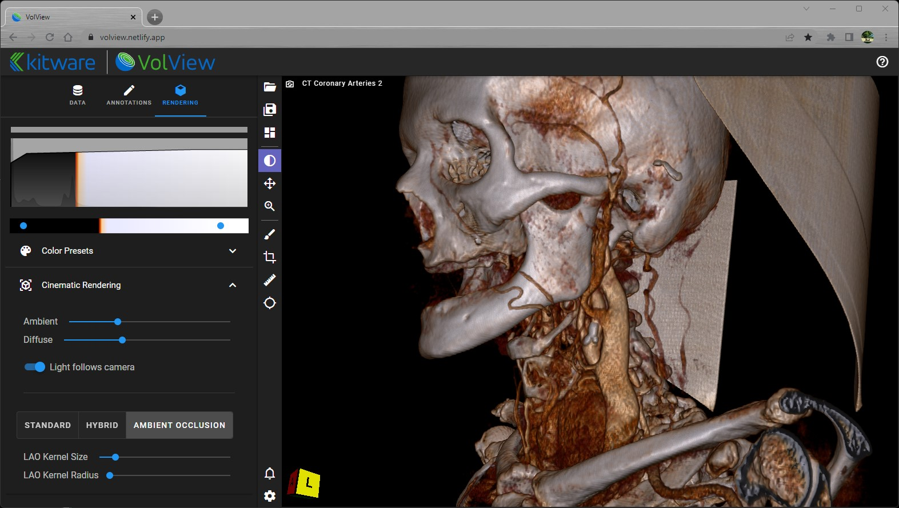
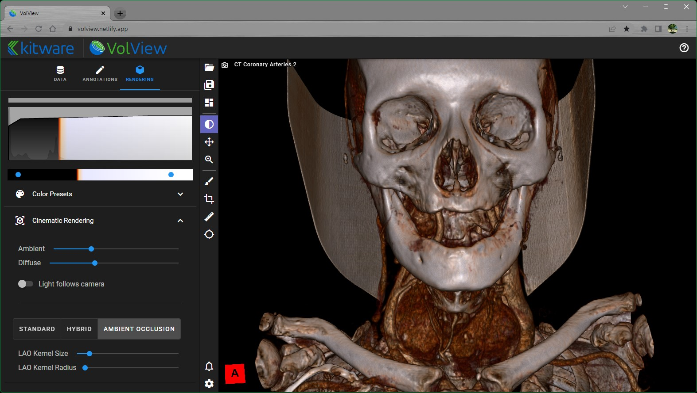
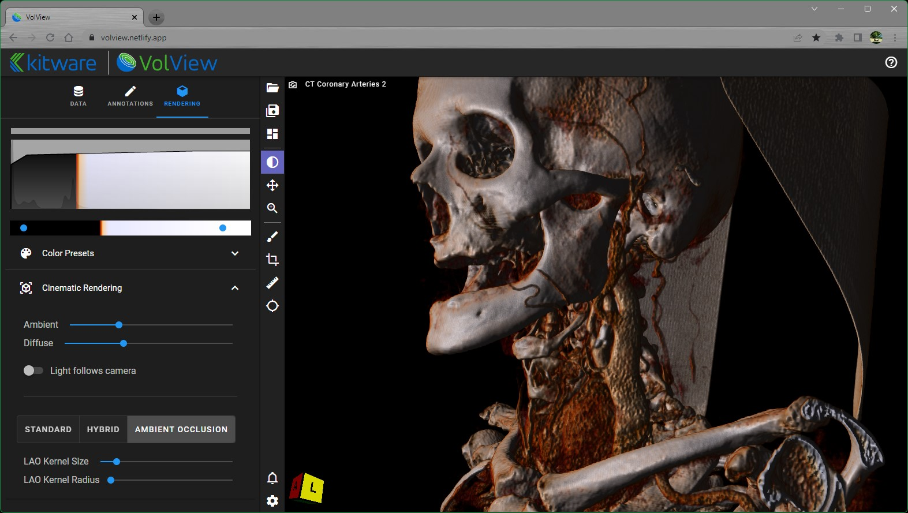

# Cinematic Volume Rendering

## Image layers in 2D views

Open **Rendering > Layers** to adjust the base image and its overlays.
**Show/Hide**, beside each color-map selector, changes visibility without
removing the image or its display settings.

- **Color map** shows palettes with gradient previews. Choosing one preserves
  the display range and other settings.
- **Display range** shows the palette across the image's full intensity range.
  Drag either end handle to change Min or Max, or drag the center handle to move
  both together while preserving their separation. A smaller arrow handle marks
  a value outside the image range. Dragging it continues from its actual value.
  The Min and Max fields below the bar also accept negative values, decimals,
  and scientific notation. Invalid or incomplete edits leave the applied range
  unchanged. Values use four significant digits, with more precision for narrow
  ranges. Hover a field to see its exact value; focusing an unchanged field
  preserves that value at full precision.
- **Contrast** opens range options. For overlays, choose Full Range or Low,
  Medium, or High Contrast based on that overlay's image statistics. The base
  image menu also offers window/level presets and manual Window and Level
  fields. Its Min and Max values represent the same window/level used by the
  toolbar and mouse controls.
- **Opacity** adjusts how strongly an overlay blends with the images beneath
  it. Its percentage appears while adjusting the slider.
- **Transparent background** makes overlay values at or below Min transparent,
  with a linear fade over the first 10% of the display range above Min. It
  retains the overlay's opacity function and overall opacity. Turn it off to
  use the palette and opacity function without this fade. It is on by default,
  including for saved sessions that omit the setting.

Overlay controls apply to every 2D view showing that overlay. Base-image
palette, range, and visibility apply to its 2D and oblique views. These settings
persist through layout changes and saved sessions, including a 3D-only layout.
The separate **3D Rendering** section can be collapsed to reach the layer
controls; its volume-rendering settings are independent.

RGB and RGBA images retain their native colors. Scalar color-map, range, and
Contrast controls are disabled for these images, as is Transparent background.
Overlay opacity and visibility remain available. Controls that require a
matching slice view remain visible and disabled when that view is unavailable,
with tooltips explaining why.

Display ranges use image values. These controls do not calculate or imply
standardized uptake values (SUV) for PET data.

## Cinematic rendering controls

VolView reads the DICOM tags of your data to determine appropriate preset parameter values for cinematic volume rendering for your data, but often you will want to tweak those presets to emphasize specific details. Rendering controls apply to the currently selected/active view. We recommend the following sequence of tweaks to improve your visualizations.

1. Cinematic volume rendering involves two "transfer functions": one maps the recorded intensity values (e.g., CT hounsfield units) to opacity and the other maps recorded intensity values to color. Both can be adjusted using the controls at the top of the Rendering tab. The graph at the top shows a histogram of the recorded intensity values in light gray and the current opacity transfer function as an overlaid curve in black. In that graph, beneath the black curve, is a depiction of the color transfer function. 
   1. Begin by adjusting the opacity transfer function by a press-and-drag right/left on the top graph. 
   2. Then adjust the color transfer function by moving the blue dots on the colorbar beneath the graph. 

2. You may decide that the colormaps and/or transfer function aren't suitable for your data. Click on the "Presets" bar to expand and show the available presets that offer alternative opacity and color transfer functions. 
   [**_Watch the video!_**](https://youtu.be/eyrGd-meg6I)

3. Next, the lighting can be controlled.
   1. Ambient lighting is the general brightness of the scene.
   2. Diffuse lighting controls how the light reflects off the data. It is influenced by the position of the light relative to the orientation of the data's local surface.
   3. Light-follows-camera can be enabled / disabled to create shadows that highlights details within the data. When enabled, the light will be positioned in-line with the camera. When disabled, the last position of the light stays fixed relative to the data, even if the camera is moved. With light-follows-camera enabled, here is a view when the light is following the camera: . By moving the camera (and thereby the light) to the front of the data and then disabling light-follows-camera, the view should look light this: . Then moving back to the side view will show shadows that emphasize depth and details: .

4. Advanced, you can also explore alternative cinematic rendering methods.
   1. Standard
   2. Hybrid
   3. Ambient Occlusion
