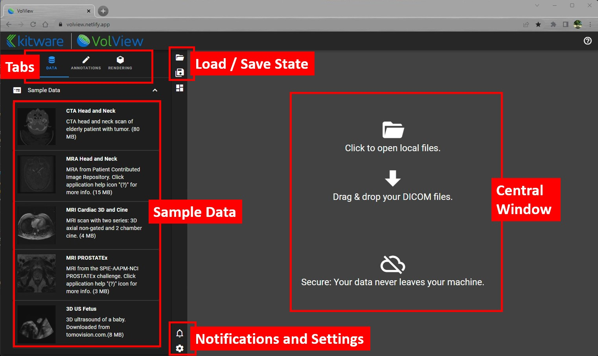

# Welcome Screen

## Tabs

### Data

Information on the Patient data and non-DICOM data that have been loaded. The currently display image data is highlighted in blue.

**Sample Data** presents datasets for exploring VolView. Select a thumbnail to
download and open its images. The PET/CT Chest sample includes a configured PET
overlay for trying the [layer display controls](./rendering.md).

### Annotations

Lists the ruler and other measures that have been made on the currently loaded data.

### Rendering

Controls for 3D cinematic rendering and 2D image overlays. See [Rendering](./rendering.md) for details.

## Load / Save State

Restore or create a local file that captures the current configuration of the application and its data. This includes the layout, annotations, cinematic rendering settings, and all other options specified. The local file is in json format, so it provides a basis for integrating VolView with other applications and workflows.

## Notifications and Settings

Information and error messages collect here. The number of recently posted notifications will appear on top of the notification icon. Settings allow you to toggle between a dark or light theme.

## Central Window

Drag-and-drop DICOM and image data here. Receives files, folders, or zip files. Or you can click within this window to bring up a file browser.
